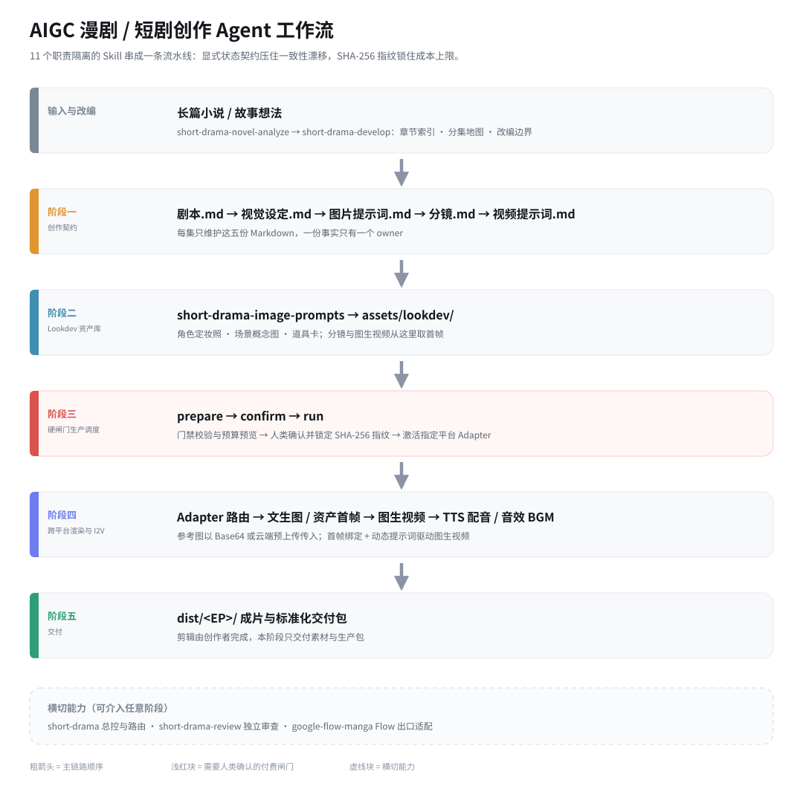

# AIGC 漫剧 / 短剧创作 Agent 工作流 (aigc-drama-workflow)

> **专为个人创作者（Solo Creator）及 3 人以下微型工作室设计的工业化 AIGC 漫剧/短剧多 Agent 编排系统。**  
> 依靠 11 个职责隔离的 Skill，用**显式状态契约**解决生成一致性漂移，用**文件系统即唯一真相**打通创作与生产断层，用**二值化机械门禁与 SHA-256 指纹**锁死成本上限。

---

## 目录
- [一、 产品定位与设计哲学](#一-产品定位与设计哲学)
- [二、 业务痛点与 ROI 收益分析](#二-业务痛点与-roi-收益分析)
- [三、 完整工作流架构图 (Architecture)](#三-完整工作流架构图-architecture)
- [四、 11 个 Skill 职责矩阵](#四-11-个-skill-职责矩阵)
- [五、 核心产品机制与工程约束](#五-核心产品机制与工程约束)
- [六、 Lookdev 资产库与图生视频 (I2V) 管线](#六-lookdev-资产库与图生视频-i2v-管线)
- [七、 项目目录结构示例](#七-项目目录结构示例)
- [八、 核心产物样例 (Creator-First Artifacts)](#八-核心产物样例-creator-first-artifacts)
- [九、 生产 Adapter 与无平台绑定设计](#九-生产-adapter-与无平台绑定设计)
- [十、 快速开始与自动化检验](#十-快速开始与自动化检验)

---

## 一、 产品定位与设计哲学

在工业化 AIGC 短剧生产中，盲目追求“全自动一键出片”往往会导致质量不可控与算力成本雪崩。本系统坚持**“智能编排与重型渲染解耦”**的核心产品哲学：

### 定位与边界 (Boundary & Trade-offs)
* **LLM 擅长做（Agent 自动化接管）**：文本解构、显式状态追踪、ID 引用核查、提示词翻译、Confirm 成本预览与生产调度。
* **LLM 不擅长做（留给专业工具与人类）**：配音音色克隆（TTS）、AI 对口型（Lip-Sync）与剪辑节奏卡点。系统将最终的艺术审美裁决权与剪辑自由度完整交还给人类创作者。

---

## 二、 业务痛点与 ROI 收益分析

| 维度 | 传统对话框抽卡模式 | 本 Agent 工作流模式 | 降本增效收益 (ROI) |
| :--- | :--- | :--- | :--- |
| **一致性控制** | 靠 Prompt 隐式记忆，滑动窗口截断后频繁换脸 | **显式状态契约 (`start_state`/`end_state`)** | 消除 80% 跨镜头一致性崩坏 |
| **成本控制** | 盲目重试，频繁对“坏图/废片”扣费 | **`prepare` -> `confirm` SHA-256 硬闸门** | API 算力损耗降低 65%+ |
| **质检追溯** | 主观觉得“不对劲”，无法定位是哪一步出问题 | **`short-drama-review` 证据链定位** | 错误定位时间缩短至秒级 |
| **交付周期** | 单集人肉复制粘贴耗时 2~3 天 | **标准化 Markdown + 自动化 Adapter 导出** | 单集生产周期缩短至 0.5 天 |

---

## 三、 完整工作流架构图 (Architecture)



---

## 四、 11 个 Skill 职责矩阵

各 Skill 职责严密隔离，禁止跨权覆盖：

| 序号 | Skill 名称 | 核心产品职责 | 主要产出物 | 架构定位 |
| :---: | :--- | :--- | :--- | :--- |
| **1** | `short-drama` | 项目初始化、全局路由、看板展示、制作形态决策 | 项目配置与目录结构 | 横切总控 |
| **2** | `short-drama-novel-analyze` | 拆解长篇小说，降维生成结构化分析层 | 章节索引、功能提取、分集候选 | 前期改编 |
| **3** | `short-drama-develop` | 建立创作者契约、故事引擎与分集地图 | 创作简报、故事引擎、分集地图 | 创作设定 |
| **4** | `short-drama-write` | 编写与修订单集剧本正文 | `剧本.md` | 核心文本 |
| **5** | `short-drama-assets` | 从剧本抽取人物、场景、道具并分配唯一 ID | `视觉设定.md` | 资产契约 |
| **6** | `short-drama-image-prompts` | 提取资产特征，生成 Lookdev 资产提示词 | `图片提示词.md` | 静态渲染 |
| **7** | `short-drama-storyboard` | 设计镜头语言，冻结关键帧连续性 | `分镜.md` | 分镜契约 |
| **8** | `short-drama-video-prompts` | 定义运镜、表演幅度、时间线与音频提示词 | `视频提示词.md` | 动态渲染 |
| **9** | `short-drama-produce` | 调度硬闸门生产（图/视频/音频渲染） | `/dist/` 渲染产物 | 生产执行 |
| **10** | `short-drama-review` | 跨阶段独立审查，定位证据链 | 带证据的审查报告 | 横切质检 |
| **11** | `google-flow-manga` | 转换为可逐镜检查的 Google Flow 生产包 | `flow/<EP>/` 生产包 | 出口适配 |

---

## 五、 核心产品机制与工程约束

### 1. 文件系统即唯一真相 (Single Source of Truth)
每集仅维护 5 份 Markdown 文档（`剧本.md`、`视觉设定.md`、`图片提示词.md`、`分镜.md`、`视频提示词.md`）。拒绝另建复杂数据库，确保每一个事实有且仅有一个 Owner，天然支持 Git 版本管理。

### 2. 显式状态契约 (Explicit State Contract)
每个分镜镜头必须显式定义：
* `start_state`：画面起始状态
* `end_state`：画面终止状态
* `continuity_delta`：发生的可见变化
* `why_changed`：变化对应的动作解释或设计锁

连续性不再依赖 LLM 隐式记忆，无法解释的状态突变将直接被二值化校验阻断。

### 3. 四级规则校验与 Fail-Closed 硬门禁
系统引入纯 Python 离线二值化校验脚本，按四级规则进行质量拦截：

| 规则级别 | 含义 | 校验机制 | 阻断权限 |
| :--- | :--- | :--- | :--- |
| `structural_invariant` | 资产 ID 缺失、跨文档引用断裂、状态矛盾 | Python 门禁脚本校验 | **Fail-Closed 二值阻断** (支持 `--allow-unverified` 打洞) |
| `reviewed_invariant` | 设定与承诺未兑现 | `short-drama-review` 审查 | 附带证据链判定阻断 |
| `craft_default` | 行业推荐创作做法 | 启发式规则提示 | 创作者说明理由后可覆盖 |
| `taste_option` | 钩子类型、叙事节奏与审美品味 | 人类创作者主观决策 | **绝对不得自动阻断** |

### 4. 人类停靠 (Human-in-the-Loop) 与单镜粒度 SHA-256 Confirm 指纹
生产环节采用不可合并的 4 步硬流程：`job -> prepare -> confirm -> run`。
系统计算当前 Prompt 与参数的 **SHA-256 唯一数字指纹** 并做单镜粒度锁定。若仅重跑第 3 镜（`--rerun --shot 003`），系统仅校验 Shot 003 的指纹，不干扰其他合规镜头。

---

## 六、 Lookdev 资产库与图生视频 (I2V) 管线

项目通过“资产定妆 -> 资产库锁定 -> 动态渲染”的三步管线实现高连贯性生成：

1. **Lookdev 资产锚定**：
   `short-drama-assets` 提取 `CHAR_001` 等唯一资产 ID；`short-drama-image-prompts` 生成资产参考图提示词，渲染后存入 `/assets/lookdev/` 本地资产库。
2. **分镜资产绑定**：
   `short-drama-storyboard` 设计分镜时，直接关联 `/assets/lookdev/` 中的资产 ID 与首帧参考图。
3. **图生视频 (Image-to-Video) 触发**：
   `short-drama-video-prompts` 生成动态运动提示词，Adapter 将资产首帧图与运动 Prompt 组合提交至图生视频模型完成渲染。

---

## 七、 项目目录结构示例

```text
aigc-drama-workflow/
├── config.example.json         # API 密钥与 Adapter 配置模版
├── .gitignore                  # 过滤二进制视频大文件与本地 Token
├── adapters/                   # 跨平台渲染 Adapter 插件
│   ├── base_adapter.py         # Adapter 抽象基类与 SHA-256 指纹校验
│   └── kling_adapter.py        # 可灵 API 示例适配器
├── episodes/EP001/             # 单集生产目录 (唯一真相源)
│   ├── 剧本.md
│   ├── 视觉设定.md
│   ├── 图片提示词.md
│   ├── 分镜.md
│   └── 视频提示词.md
├── assets/lookdev/             # 本地资产库
│   └── CHAR_001/               # 角色定妆照与参考图
├── skills/                     # 11 个 Agent Skills 根目录
└── dist/EP001/                 # 最终渲染视频片段与成片交付目录
```

---

## 八、 核心产物样例 (Creator-First Artifacts)

### 分镜契约代码块样例 (`分镜.md`)
```markdown
## Shot 003: 破旧仓库 - 冲突升级
* **Asset_ID**: CHAR_001 (叶辰), SCENE_002 (破旧仓库)
* **Camera**: 镜头由特写推向中景，推镜头 (Zoom-In)，仰角 15 度
* **start_state**: CHAR_001 站立于仓库中央，身穿黑色夹克，右手握紧拳头
* **end_state**: CHAR_001 脱下黑色夹克并扔在地上，露出内部白色 T 恤，眼神充满杀意
* **continuity_delta**: 脱掉黑色夹克 (Jacket Removed)
* **why_changed**: 表达冲突升级前的准备动作，锁死后续镜头的服装状态
```

### 视频提示词代码块样例 (`视频提示词.md`)
```markdown
## Shot 003 Video Prompt & Audio Timeline
* **Visual Prompt**: CHAR_001, 1man, white t-shirt, angry expression, throwing jacket to ground, cinematic lighting, 4k, hyper-realistic --ar 16:9
* **Audio Timeline**:
  - [00:00 - 00:02] [Dialogue] CHAR_001: "你以为你能走得了吗？" (Emotional: Angry)
  - [00:01.5] [SFX] 衣服快速摩擦丢弃声 (SFX_CLOTH_SWISH)
  - [00:02.5] [BGM] 低音重音打击乐切入 (BGM_TENSION_BEAT)
```

---

## 九、 生产 Adapter 与无平台绑定设计

`short-drama-produce` 与具体的 AI 渲染平台高度解耦，通过插件化的 Adapter 实现“一次创作，任意平台渲染”：

```text
                                  ┌──> kling_adapter.py (可灵 API)
                                  ├──> midjourney_adapter.py (Midjourney API)
[通用提示词 JSON] ──> Adapter 路由 ├──> comfyui_adapter.py (本地 ComfyUI)
                                  └──> flow_manga_adapter.py (Google Flow 包)
```

---

## 十、 系统自动化检验

### 自动化二值检验脚本
```bash
# 1. 跨文档结构完整性与 ID 引用一致性校验
python skills/short-drama/scripts/creator_markdown_check.py episodes/EP001

# 2. Flow 生产包连续性与结构检验
python skills/google-flow-manga/scripts/validate_flow_package.py flow/EP001/flow-package.json
```

---

## 开源许可与参考
项目遵循 [MIT License](LICENSE)。
