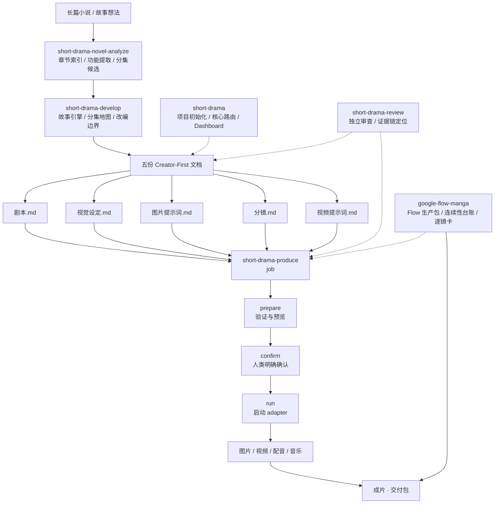

# AIGC 漫剧创作工作流 (aigc-drama-workflow)

[](docs/installation.md)
[](LICENSE)
[](https://agentskills.io/specification)
[](docs/installation.md)

> 面向 AIGC 漫剧 / 短剧创作的 Agent 工作流：11 个职责隔离的 Skill，用显式状态契约解决生成一致性，用机械门禁守住质量底线。

## 项目速览

| 维度 | 内容说明 |
| :--- | :--- |
| **定位** | 面向工业化 AIGC 漫剧 / 短剧生产的多 Agent 工作流编排系统 |
| **解决痛点** | 角色与时空一致性漂移、创作与生产断层、质量不可追溯（「AI 味」与抽卡黑盒） |
| **核心产品策略** | 11 个职责隔离 Skill + 显式状态契约（`continuity_delta`）+ 规则四级分级 + Fail-Closed 硬门禁 |
| **创作者交互** | 机器负责可证明的校验，人负责真实创作分叉点；关键节点通过人类停靠确认 |
| **业务验证** | 在一个 58 集规模的竖屏漫剧改编项目上跑通首集全流水线：剧本、视觉设定、图片提示词、分镜、视频提示词、图片 / 视频生产与成片回审 |
| **可复核结果** | 最小示例的两类结构校验均通过：`0 error(s), 0 warning(s), 3 shot(s)` |

这不是一个把提示词串起来的工具集合，而是一套把**长篇小说 / 故事想法**转成**可交付成片与生产包**的创作基础设施。它把模型最难稳定完成的部分——跨镜头状态、一致性、责任边界和质量定位——变成文件契约、流程状态与可执行门禁。

## 业务问题与产品解法

模型已经能生成漂亮的单帧，但单帧质量不等于连续剧生产能力。这个项目把问题拆成三个产品层面的约束：

| 结构性问题 | 典型表现 | 产品解法 | 直接收益 |
| :--- | :--- | :--- | :--- |
| **一致性漂移** | 同一角色跨镜头换脸、换服装；同一场景换个角度就变成另一个房间 | 放弃模型的隐式记忆，强制记录 `start_state`、`end_state`、`continuity_delta`，每个可见变化都要有 `why_changed` | 把「看起来不对」转成可检查的状态矛盾，问题可定位到具体镜头 |
| **创作与生产断层** | 剧本、设定、分镜、提示词散落在不同工具里；改一处不知道会波及哪些下游产物 | 以文件系统为唯一真相，建立 5 份 Creator-First 文档，并为每份产物指定唯一 owner | 下游引用有来源，返工沿依赖关系回溯，不靠创作者记忆维护项目状态 |
| **质量不可追溯** | 「AI 味」「不够电影感」没有证据链，问题定位不到具体环节，只能整批重抽 | 由独立的 `short-drama-review` 输出位置、证据、影响、修订结果、owner 与规则等级 | 审查结论可复核，修订责任明确，主观判断不伪装成硬性评分 |

核心判断是：这三个问题都不是简单更换模型就能解决的。模型负责生成，工作流负责约束生成如何被组织、校验和交付。

## 工作流架构



架构中有两条横切能力：

- `short-drama` 负责项目初始化、跨阶段调度、本地 Dashboard、制作形态与视觉方向决策，不直接创作阶段正文。
- `short-drama-review` 可在任意阶段介入，只输出问题、证据、影响与修订要求，不替代来源文件的 owner 修改。

生产环节采用不可合并的四步硬闸门：

```text
job → prepare → confirm → run
```

`prepare` 只验证并展示数量、提示词、来源、参考绑定、输出路径与 adapter，不生产；`confirm` 只保存与当前 job 指纹绑定的一次性确认；`run` 才启动生产。job、prompt、参数或输出路径发生变化，旧确认立即失效。

## 11 个 Skill 矩阵

| Skill | 产品职责 | 主要产物 |
| :--- | :--- | :--- |
| `short-drama` | 项目初始化、跨阶段路由、Dashboard、制作形态决策 | 项目配置与目录结构 |
| `short-drama-novel-analyze` | 把长篇小说拆成可追溯的分析层 | 章节索引、功能提取、分集候选 |
| `short-drama-develop` | 建立创作者契约、故事引擎与分集地图 | 创作简报、故事引擎、分集地图 |
| `short-drama-write` | 单集剧本写作与修订 | `剧本.md` |
| `short-drama-assets` | 从剧本拆出人物、地点、道具与连续性状态 | `视觉设定.md` |
| `short-drama-image-prompts` | 生成资产图片与 lookdev 提示词 | `图片提示词.md` |
| `short-drama-storyboard` | 设计镜头职责、空间关系与冻结关键帧 | `分镜.md` |
| `short-drama-video-prompts` | 定义运动、表演、声音与时间线提示词 | `视频提示词.md` |
| `short-drama-produce` | 在确认后执行图片、视频、配音和音乐生产 | `制作成果/` |
| `short-drama-review` | 执行带证据链的跨阶段审查 | 审查报告 |
| `google-flow-manga` | 把分镜转换成可检查、可逐镜执行的 Flow 生产包 | `flow/<EP>/` |

## 核心产品机制

### 文件系统即唯一真相

每集只维护 5 份创作者可读的 Markdown：`剧本.md`、`视觉设定.md`、`图片提示词.md`、`分镜.md`、`视频提示词.md`。项目拒绝另建 episode card、节拍表、QA 记录等并行真相。一份事实只有一个 owner，修改只有一条路径。

这是一项有意识的产品选择：Markdown 比结构化数据库更适合创作者阅读、审查和否决；机械可校验性则由字段级格式约定与 Python 校验脚本补足。

### 显式状态契约

每个镜头必须写清：

- `start_state`：镜头从什么状态开始
- `end_state`：镜头结束时变成什么状态
- `continuity_delta`：发生了哪些可见变化
- `why_changed`：变化由什么动作、事实或设计锁解释

连续性不再依赖模型「记得上一镜角色穿什么」，而是变成可校验的状态契约。无法用前镜、世界规则、明确设计锁或当前动作解释的变化，视为连续性风险。

### owner 边界

每个 Skill 只写自己的产物。下游发现上游问题时，写审查报告并路由回正确的层，而不是顺手改掉来源文件。这样可以避免 A 修改 B 的产物后，B 下次运行把它覆盖掉；也避免 B 基于被污染的输入继续工作。

### 机械门禁 + 人类停靠

可证明的交给脚本，需要判断的交给创作者：

- 机械门禁离线运行，结果是二值的，并采用 **Fail-Closed**：有错误就停，不把错表带入下一阶段。
- 人类停靠只发生在真实创作分叉点，例如原著快评后是否继续全量拆解、生产预览后是否确认花费预算。
- 机器负责证明，人负责判断；审查结果不能用无证据的分数替代。

### 规则四级分级

| 级别 | 含义 | 阻断权限 |
| :--- | :--- | :--- |
| `structural_invariant` | 引用完整性、ID、显式状态矛盾 | 脚本可阻断 |
| `reviewed_invariant` | 升级是否真实、承诺是否兑现 | 审查带证据判定 |
| `craft_default` | 通常有帮助的创作做法 | 创作者说明理由后可覆盖 |
| `taste_option` | 钩子、弧线、开篇和结局气质 | 不得单独阻断 |

集数、钩子类型、是否反转和高潮位置由创作者与项目决定，不用固定配方替代因果判断。

## 产品 Trade-off

| 决策 | 放弃了什么 | 换来了什么 | 适用边界 |
| :--- | :--- | :--- | :--- |
| **文件系统优先于数据库** | 查询、事务和复杂关系管理能力 | 创作者可以直接阅读、否决和修改；产物天然可进入 Git 版本管理 | 适合文档驱动的创作生产，不替代在线协同数据库 |
| **显式状态优先于模型记忆** | 少量格式自由度与即时生成速度 | 连续性变化可解释、可审查、可定位 | 适合跨镜头、跨场、跨集的连续剧生产 |
| **人类停靠优先于全自动生产** | 无法从输入一路自动生成到成片 | 把预算、审美和制作方向的最终判断留给创作者 | 生产 adapter 可自动执行，但不得自动绕过确认 |
| **规则分级优先于一套硬规则** | 不能用统一模板快速裁决所有创作选择 | 结构错误能阻断，审美选择保留弹性 | 适合既要质量底线、又不能绑死创作的场景 |

这些折中共同指向一个产品边界：系统自动化的是**状态管理、依赖传递、校验和生产准备**，而不是替创作者决定故事价值与审美方向。

## 技术落地与快速开始

### 运行要求

- **Python 3.13+**：校验脚本使用了 `Path.is_dir(follow_symlinks=)`、`Path.is_file(follow_symlinks=)` 等 3.13 才引入的 API。
- **仅使用 Python 标准库**：项目本体无第三方 Python 依赖。
- **跨平台**：支持 Windows、macOS、Linux。

Windows 下若没有 `python3` 命令，可以使用 `py -3`，或为 Python 3.13 建立 `python3` 别名。

### 安装

```bash
git clone https://github.com/jjjjjinshan/aigc-drama-workflow.git
cd aigc-drama-workflow
```

本工作流基于 [Agent Skills 标准](https://agentskills.io/specification)，可放入支持该标准的 Agent 宿主。不同宿主的安装路径见 [安装说明](docs/installation.md)。

### 最小流程

```text
用 $short-drama 初始化一个漫剧项目
用 $short-drama-write 写 EP001 的剧本
用 $short-drama-assets 从剧本拆出视觉设定
用 $short-drama-storyboard 完成分镜和冻结关键帧
用 $short-drama-video-prompts 把分镜写成视频提示词
```

## 验证、文档与兼容性

### 最小示例

完整示例位于 [`examples/minimal-drama/`](examples/minimal-drama/)。它包含一个原创的 EP001，演示 5 份 Creator-First 文档如何通过稳定 ID、连续性状态和 Flow 生产包互相引用。

在 `examples/minimal-drama/` 目录执行：

```bash
# 跨文档结构与 ID 一致性
python ../../skills/short-drama/scripts/creator_markdown_check.py 剧集/EP001 --project-root .
# 预期：OK: 剧集/EP001

# Flow 生产包结构与连续性
python ../../skills/google-flow-manga/scripts/validate_flow_package.py flow/EP001/flow-package.json
# 预期：OK: 0 error(s), 0 warning(s), 3 shot(s)
```

### 文档导航

- [架构说明](docs/architecture.md)：五层流水线与横切能力
- [工作流详解](docs/workflow.md)：六阶段的输入、动作、产出与门禁
- [设计原则](docs/design-principles.md)：五个核心机制的设计依据
- [安装说明](docs/installation.md)：pi、Codex、Claude Code 等宿主的安装方式

### 项目结构

```text
aigc-drama-workflow/
├── skills/          # 11 个 Skill（Agent Skills 标准）
├── docs/            # 架构、工作流、设计原则与安装文档
├── examples/        # 原创示例项目
├── LICENSE
├── NOTICE.md        # 第三方来源声明
└── CHANGELOG.md
```

### 兼容性与许可

Skill 不绑定特定模型或供应商，生产端通过 adapter 契约对接。项目部分内容改编自第三方 MIT 项目，具体来源见 [NOTICE.md](NOTICE.md)。项目本身采用 [MIT License](LICENSE)。
